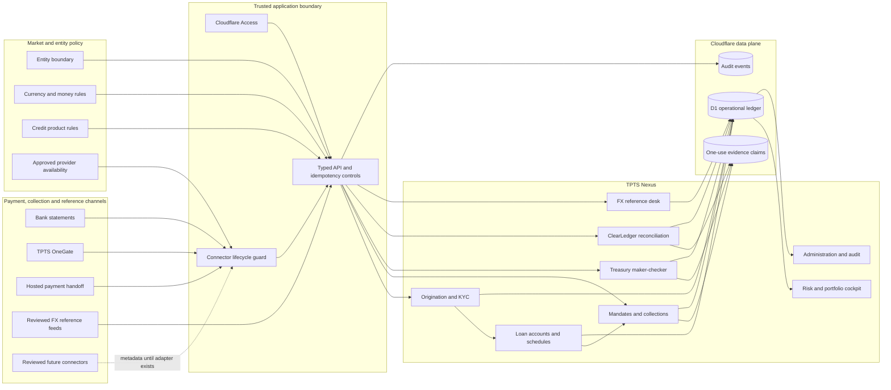

# TPTS Nexus architecture

**Namibian-born · Africa-ready.** The architecture separates market-specific
activation from the financial controls that must remain invariant everywhere.

## Trust boundaries

1. Identity is verified before application membership and permissions are
   evaluated.
2. Connector lifecycle state is enforced in both the interface and server
   route; the server remains authoritative.
3. A provider return URL never proves settlement.
4. Imported or provider evidence must match amount, currency, direction,
   timing and unclaimed status.
5. Evidence, balances, schedules, liquidity, operation status and audit records
   commit atomically.
6. FX reference rates are indicative only and never authorise a debit,
   settlement, posting, refund or provider instruction.
7. The public case study contains no private source or runtime configuration.

## Invariants and adaptable layers

| Invariant control | Market-adaptable layer |
| --- | --- |
| Authenticated identity and scoped permissions | Entity membership and local roles |
| Integer minor-unit money arithmetic | Currency and display conventions |
| Maker-checker separation | Approval thresholds and policies |
| Provider or bank evidence for settlement | Activated rails and bank formats |
| Separation of reference FX from execution quotes | Reviewed rate providers and display pairs |
| Idempotent financial mutations | Product and workflow configuration |
| Atomic ledger and audit updates | Country-specific reporting integrations |

This separation lets TPTS expand without copying the platform into divergent
country editions or weakening the evidence chain.
